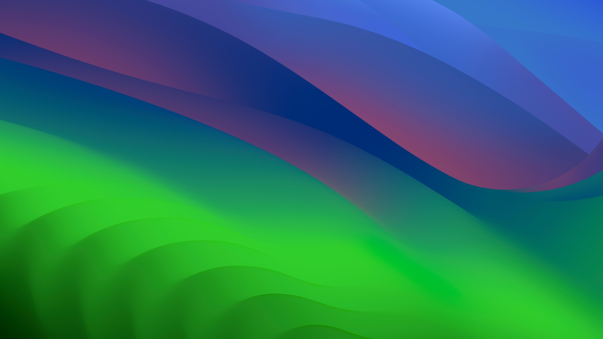

# Cupertino Glass 🪟🍎

A refined macOS-inspired clear frosted glass theme for [Omarchy](https://omarchy.org/) Linux with Hyprland.



---

## ✨ Features

- **Frosted Glass Vibrancy**: Translucent Quickshell status bar (`background-alpha = 0.35`), notification banners, flyouts, and menus rendered with deep Wayland background blur.
- **Apple HIG Color Palette**: Authentic Apple Human Interface Guidelines palette featuring System Blue (`#0A84FF`), Apple system accents (Red, Orange, Yellow, Green, Cyan, Purple), and sleek neutral dark glass base tones.
- **macOS Window Geometry**:
  - **Corner Rounding**: 12px smooth window corners matching macOS window geometry.
  - **Retina Borders**: 1px subtle border with vibrant Apple Blue active accents.
  - **Soft Drop Shadows**: 28px deep, realistic drop shadows for floating windows.
  - **Multi-Pass Blur**: Dual-pass Kawase background blur with vibrancy and popup blur enabled.
- **Terminal Translucency**: Configured out of the box with `0.85` background opacity and blur for Ghostty, Kitty, and Alacritty.
- **Curated 4K Wallpapers**: Bundled with 5 high-resolution macOS wallpapers (Sonoma, Monterey, Ventura, WhiteSur).

---

## 📦 Installation

### Option 1: One-Line Install via Omarchy CLI

```bash
omarchy theme install https://github.com/<your-username>/omarchy-cupertino-glass.git
```

### Option 2: Full Local Installation (Recommended)

To enable custom window geometry rules (12px rounding, soft drop shadows, and terminal opacity overrides), clone or copy the theme directly into your user themes directory:

```bash
git clone https://github.com/<your-username>/omarchy-cupertino-glass.git ~/.config/omarchy/themes/cupertino-glass
omarchy theme set "Cupertino Glass"
```

---

## 🚀 Usage

### Apply the Theme
```bash
omarchy theme set "Cupertino Glass"
```

### Cycle Wallpapers
```bash
omarchy theme bg next
```

### Open Graphical Theme Switcher
```bash
omarchy theme-switcher
```

---

## 📁 Repository Structure

```text
omarchy-cupertino-glass/
├── colors.toml         # Base palette and Apple HIG color definitions
├── shell.toml          # Omarchy shell surfaces (bar, popups, menus, notifications)
├── hyprland.lua        # Hyprland window decorations, blur passes, and layer rules
├── ghostty.conf        # Ghostty terminal styling (opacity + blur)
├── kitty.conf          # Kitty terminal styling (opacity + blur)
├── alacritty.toml      # Alacritty terminal styling (opacity + blur)
├── icons.theme         # System icon theme (Yaru-blue)
├── preview.png         # High-resolution theme preview image
└── backgrounds/        # 4K macOS wallpapers
    ├── 01-Sonoma-Dark.jpg
    ├── 02-Monterey-Dark.jpg
    ├── 03-Ventura-Dark.jpg
    ├── 04-WhiteSur-Dark.jpg
    └── 05-Sonoma-Light.jpg
```
